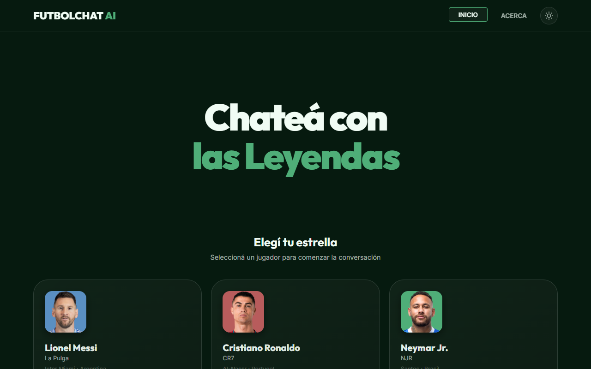
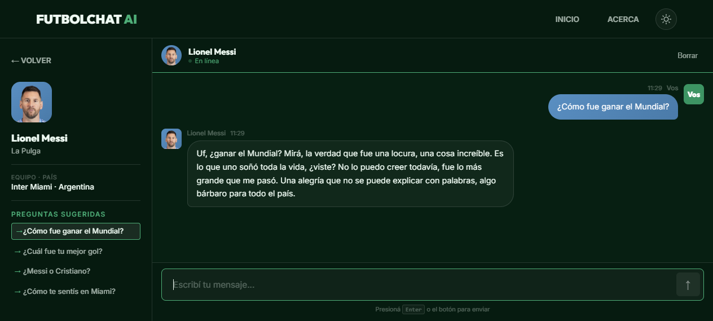
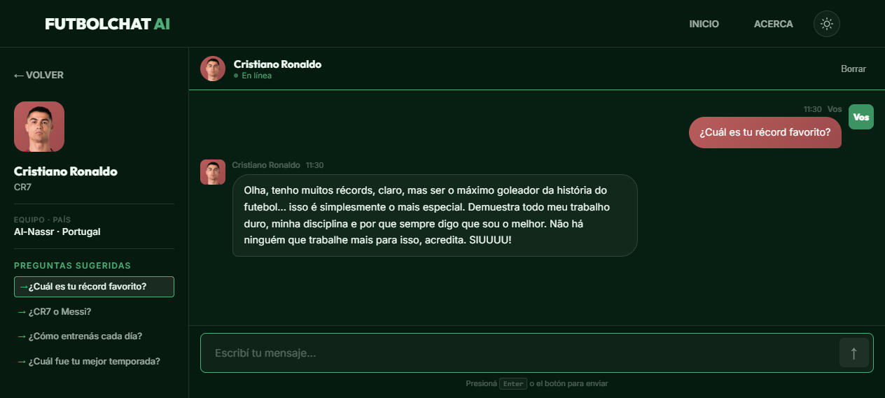
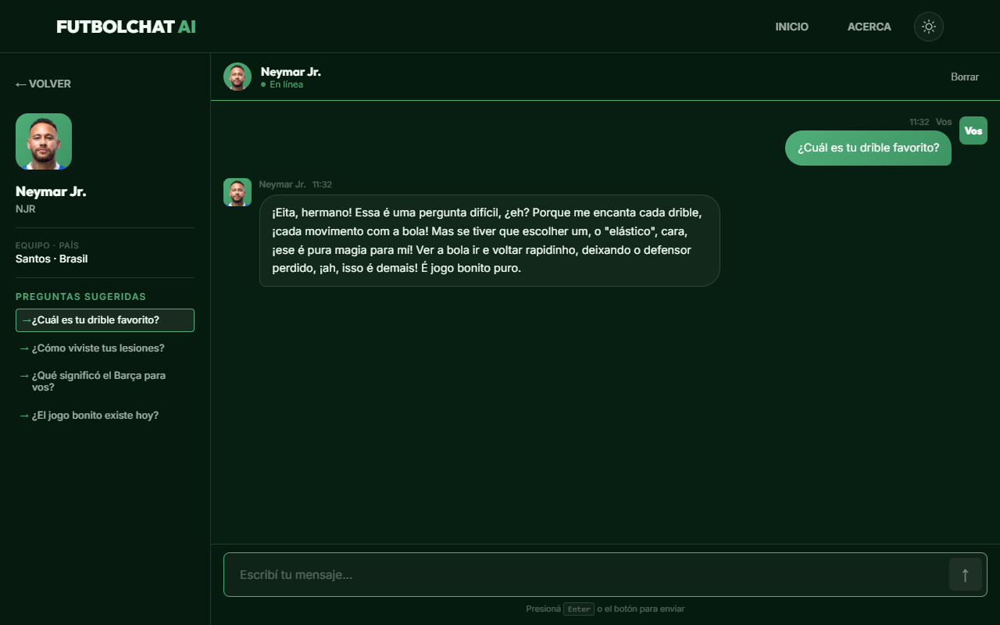

# FutbolChat AI

> Chateá con Messi, Cristiano Ronaldo y Neymar. Las respuestas las genera Gemini.

SPA que se conecta a la API de Gemini desde una función de Vercel. Más trabajos en mi portfolio: https://portfolio-fawn-kappa-35.vercel.app

---

## Link a la aplicación desplegada

 **[https://futbolchat-ai.vercel.app](https://futbolchat-ai.vercel.app)**

---

## Los Personajes

| Jugador           | Apodo      | País          | Descripción                                                                       |
| ----------------- | ---------- | ------------- | --------------------------------------------------------------------------------- |
| **Lionel Messi**  | La Pulga | Argentina | 8 Balones de Oro, Campeón del Mundo 2022. Habla con modismos rioplatenses.        |
| **Cristiano Ronaldo** | CR7 | Portugal | 5 Balones de Oro, máximo goleador de la historia. Seguro de sí mismo, dice SIUUUU. |
| **Neymar Jr.**    | NJR      | Brasil    | Campeón Olímpico, el jogo bonito. Alegre, mezcla palabras en portugués.           |

Cada personaje tiene un **system prompt único** que define su personalidad, forma de hablar y conocimiento. Los prompts solo viven en el servidor (Vercel Function) y nunca se exponen al cliente.

---

## Stack Tecnológico

- **Frontend:** HTML5 semántico · CSS3 Vanilla (mobile-first) · JavaScript ES Modules
- **Routing:** History API (`pushState` / `popstate`)
- **IA:** [Google Gemini API](https://ai.google.dev) — modelo `gemini-2.5-flash`
- **Backend seguro:** Vercel Serverless Functions (`/api/functions.js`)
- **Persistencia:** `localStorage` para historial de conversación
- **Tests:** Vitest + jsdom
- **Deploy:** Vercel

---

## Estructura del Proyecto

```text
/
├── api/
│   └── functions.js        ← Vercel Serverless Function (proxy seguro a Gemini)
├── src/
│   ├── styles.css          ← diseño completo, dark/light mode, mobile-first
│   ├── app.js              ← Router (History API) + vistas Home y About + tema
│   ├── chat.js             ← lógica del chat, fetch, localStorage
│   └── utils.js            ← funciones puras de transformación de datos + CHARACTERS
├── tests/
│   ├── utils.test.js       ← tests para utils.js
│   └── app.test.js         ← tests para Router, renderHome, renderAbout, theme
├── index.html              ← shell de la SPA
├── .env.example            ← plantilla de variables de entorno
├── vercel.json             ← rewrites para SPA routing
├── vitest.config.js        ← configuración de Vitest
├── package.json
└── README.md
```

---

## Requisitos Previos

- [Node.js](https://nodejs.org) ≥ 18
- [Vercel CLI](https://vercel.com/docs/cli): `npm install -g vercel`
- Una API key de [Google AI Studio](https://aistudio.google.com) (gratuita)

---

## Ejecutar Localmente

### 1. Clonar el repositorio

```bash
git clone https://github.com/Enzo20011/futbolchat-ai.git
cd futbolchat-ai
```

### 2. Instalar dependencias

```bash
npm install
```

### 3. Configurar variables de entorno

```bash
# Copiá el archivo de ejemplo
cp .env.example .env.local

# Abrí .env.local y pegá tu API key de Google AI Studio
# GEMINI_API_KEY=AIza_xxxxxxxxxxxxxxxx
```

### 4. Iniciar el servidor de desarrollo

```bash
vercel dev
```

La aplicación estará disponible en `http://localhost:3000`.

> **¿Por qué `vercel dev` y no un simple servidor HTTP?**
> Porque necesitamos que las Serverless Functions de `/api/` también corran localmente.
> `vercel dev` levanta tanto los archivos estáticos como las functions en un solo comando.

---

## Ejecutar Tests

```bash
# Correr todos los tests una sola vez
npm test

# Modo watch (re-corre al guardar cambios)
npm run test:watch
```

Los tests se encuentran en `/tests/` y usan **Vitest** con entorno **jsdom**.

- `utils.test.js` — +30 tests para: `escapeHtml`, `formatTimestamp`, `parseApiResponse`, `createMessageObject`, utilidades de localStorage, `truncateText` y datos de `CHARACTERS`
- `app.test.js` — +20 tests para: `Router` (navegación, RegExp, 404, links activos), `renderHome`, `renderAbout`, `initTheme` y `toggleTheme`

---

## Desplegar en Vercel

### 1. Instalar Vercel CLI (si no lo tenés)

```bash
npm install -g vercel
```

### 2. Login en Vercel

```bash
vercel login
```

### 3. Deploy

```bash
vercel --prod
```

### 4. Agregar la variable de entorno en Vercel

En el **Dashboard de Vercel** → tu proyecto → **Settings** → **Environment Variables**:

| Variable          | Valor                          |
| ----------------- | ------------------------------ |
| `GEMINI_API_KEY`  | tu API key de Google AI Studio |

O por CLI:

```bash
vercel env add GEMINI_API_KEY
```

---

## Uso de IA

Durante el desarrollo usé asistentes de IA para consultas puntuales.

## Capturas de Pantalla

### Página de Inicio – Selección de jugador


### Chat con Lionel Messi


### Chat con Cristiano Ronaldo


### Chat con Neymar Jr.


---

## Licencia

MIT
